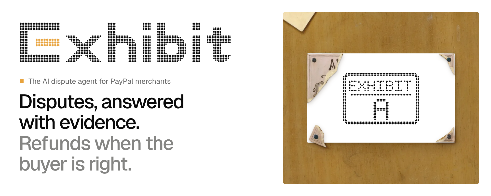

  <picture>
    <source media="(prefers-color-scheme: dark)" srcset="assets/banner-dark.png">
    
  </picture>

  <b>Exhibit is the AI dispute agent for PayPal merchants.</b> 
  It investigates each dispute with Claude, cites every claim to a real record, files through PayPal's Disputes API when the merchant approves, and refunds when the buyer is right.

  <a href="https://exhibit.9to5code.com"><b>Website</b></a> ·
  <a href="https://exhibit.9to5code.com/proof">Live sandbox proof</a> ·
  <a href="https://exhibit.9to5code.com/docs">Docs</a> ·
  <a href="https://exhibit.9to5code.com/contact">Book a demo</a>
  <!-- VIDEO_URL -->
  <!-- REPO: add <a href="https://github.com/exhibitlabs/exhibit">Repository</a> once the repository is public -->

  Built for the <a href="https://paypalaihackathon.devpost.com/">PayPal AI Hackathon 2026</a> by its co-founders, 
  <a href="https://github.com/shvuuuu">Shivansh Dwivedi</a> and <a href="https://github.com/someetshende">Someet Shende</a>.

  Painting: William Michael Harnett, <i>The Artist's Letter Rack</i>, 1879, The Metropolitan Museum of Art, CC0. Exhibit is not affiliated with or endorsed by PayPal.

